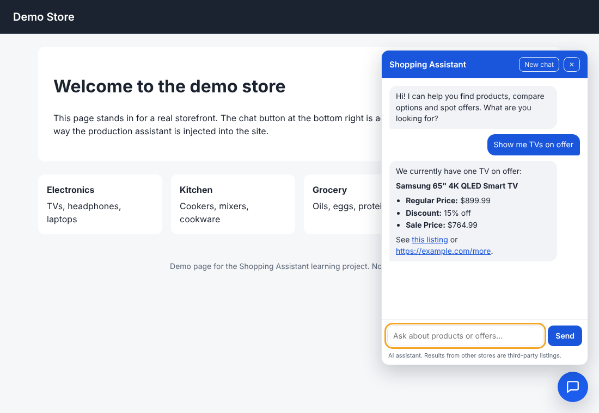

# Shopping Assistant

A learning project: an AI shopping assistant built from scratch with **Spring Boot + Gemini**, mirroring the
architecture of a production storefront integration. The assistant answers shopping questions by calling
**tools** instead of guessing, and it has **two product sources**:

| Tool | Source | When it is used |
|---|---|---|
| `search_products` | Our own local catalog (15 sample products, in-memory H2 database) | Tried **first**. Fast, free, works offline. |
| `search_web_products` | Google Shopping through [SerpApi](https://serpapi.com) | When the catalog has nothing suitable, or the customer wants a wider range, other brands or comparisons. Uses SerpApi credits. |

Web results are other retailers' listings. The assistant must name the store and never present them as this
store's own prices or offers.

## How a question is answered
```
POST /api/chat {"message": "...", "sessionId": "..." (optional)}
  -> ConversationStore: load earlier turns of this session (memory)
  -> AgentService (agent loop, max 5 rounds)
       -> GeminiClient -> Gemini API: "answer, or ask for a tool"
       -> if a tool is requested: ShoppingTools runs it
            -> search_products      -> CatalogService (local database)
            -> search_web_products  -> SerpApiClient  (Google Shopping)
       -> tool result goes back to Gemini -> final text answer
  -> ConversationStore: save this question + answer
  -> {"reply": "...", "sessionId": "..."}
```
**Memory:** the reply includes a `sessionId`; send it back with the next message to ask follow-ups
("which one is cheapest?"). Only questions and final answers are remembered (not tool results). History is kept
in the server's memory behind a `ConversationStore` interface, so a database version can replace it later.
Safety limits: at most 5 agent rounds and 3 web searches per question; identical web searches are cached for
10 minutes to save credits.

**Resilience:** if Gemini answers with a temporary error (HTTP 429, 500, 502, 503, 504), the call is retried up
to 3 times (waiting 1s, then 2s). If the main model is still failing, the whole question is restarted on the
**fallback model**. If that fails too, the customer gets "The assistant is busy right now. Please try again in
a moment." Errors that retrying cannot fix (bad key, bad request) fail immediately with Gemini's message.

## Mapping to the production architecture
| Production (Costco + Google) | This project |
|---|---|
| Adobe Target script + Google SDK widget | Chat widget (planned) |
| Apigee gateway | Gateway layer (planned) |
| Token Issuer API (JWT) | Token service (planned) |
| Google Shopping Agent + LLM | `AgentService` + Gemini |
| Google Retail Search / catalog | Local catalog + SerpApi web search |
| Analytics events | Analytics events (planned) |

## Chat widget
Run the app and open **http://localhost:8080/**: a demo "store" page with a chat button at the bottom right.



The widget is one self-contained script (`src/main/resources/static/widget/shopping-assistant.js`, no
dependencies), the local stand-in for the script Adobe Target injects into the real site. Adding it to any page is
one line:
```html
<script src="/widget/shopping-assistant.js" data-api-url="/api/chat" data-title="Shopping Assistant"></script>
```
Options: `data-api-url`, `data-title`; or set `window.ShoppingAssistantConfig = { apiUrl, title }` before the
script loads (use this when the script is injected dynamically, where `document.currentScript` is unavailable).

What it does: floating button and chat panel, suggestion chips, typing indicator, "New chat", keeps the
`sessionId` in `sessionStorage` (survives a reload, per tab), friendly error messages, dark mode, full-screen on
phones, keyboard support (Enter sends, Shift+Enter new line, Escape closes), screen-reader labels.

Design points:
- **Shadow DOM:** the widget's styles cannot leak into the host page, and the page's styles cannot break the widget.
- **Safe rendering:** the model's Markdown (bold, bullets, links) is built with DOM nodes, never `innerHTML`, and
  only `http(s)` links are made clickable, so model or web-page text cannot run as script.
- **Analytics hook:** it dispatches a `shopping-assistant` event on `window` with `detail.type` =
  `assistant_opened`, `query_sent`, `response_received`, `link_click` or `new_chat`.

## Setup
Requires **Java 21**. Maven is not needed: the Maven Wrapper (`mvnw`) is included.

### 1. API keys (never commit them)
| Variable | Where to get it |
|---|---|
| `GEMINI_API_KEY` | https://aistudio.google.com/apikey |
| `SERPAPI_API_KEY` | https://serpapi.com/manage-api-key (250 free searches) |

Set them either way:
- **IntelliJ:** Run > Edit Configurations > select the Spring Boot configuration > Environment variables:
  `GEMINI_API_KEY=...;SERPAPI_API_KEY=...`. Do **not** tick "Store as project file" (it would put the keys
  into `.run/` in the repo).
- **PowerShell (permanent, per laptop):**
  ```powershell
  [Environment]::SetEnvironmentVariable("GEMINI_API_KEY", "your_key", "User")
  [Environment]::SetEnvironmentVariable("SERPAPI_API_KEY", "your_key", "User")
  ```
  Then open a **new** terminal. A missing key only disables that feature: without `SERPAPI_API_KEY` the
  catalog search still works.

### 2. Settings (`src/main/resources/application.properties`)
`gemini.model`, `gemini.fallback-model` (blank = no fallback), `gemini.max-attempts`, `gemini.retry-delay-millis`,
`conversation.max-turns` (10), `conversation.ttl-minutes` (30), `conversation.max-sessions` (1000),
`gemini.base-url`, `serpapi.base-url`, `serpapi.max-results`. Keys are read from the
environment variables above, never from this file.

### 3. Run
```powershell
.\mvnw.cmd spring-boot:run        # Windows
./mvnw spring-boot:run            # Mac / Linux
```
The app listens on http://localhost:8080.

## Try it
```powershell
# Plain catalog search (no AI)
Invoke-RestMethod "http://localhost:8080/api/products/search?q=tv&onlyOffers=true"

# Chat. ".reply" prints just the answer text
(Invoke-RestMethod -Method Post -Uri http://localhost:8080/api/chat -ContentType "application/json" -Body '{"message":"Do you have tvs on offer?"}').reply

# Triggers the web search (the catalog has no espresso machines)
(Invoke-RestMethod -Method Post -Uri http://localhost:8080/api/chat -ContentType "application/json" -Body '{"message":"Do you sell espresso machines?"}').reply
```

Follow-up question in the same conversation:
```powershell
$r = Invoke-RestMethod -Method Post -Uri http://localhost:8080/api/chat -ContentType "application/json" -Body '{"message":"Show me TVs"}'
$r.reply
$body = @{ message = "Which one is cheapest?"; sessionId = $r.sessionId } | ConvertTo-Json
(Invoke-RestMethod -Method Post -Uri http://localhost:8080/api/chat -ContentType "application/json" -Body $body).reply
```
The app log shows each tool call, e.g. `model called tool search_web_products with {...}`.

## Endpoints
| Method | Path | Description |
|---|---|---|
| GET | `/api/products/search` | Catalog search. Optional params: `q`, `category`, `maxPrice`, `onlyOffers` |
| POST | `/api/chat` | Body `{"message": "...", "sessionId": "<uuid>"}`. `message` is 1 to 2000 characters; `sessionId` is optional. Returns `{"reply": "...", "sessionId": "..."}` |

## Project layout
```
src/main/java/com/example/shoppingagent/
  catalog/     Product, repository, CatalogService, seed data, REST endpoint
  chat/        ChatController, AgentService (agent loop), GeminiClient, ShoppingTools
  conversation/ ConversationStore (interface), InMemoryConversationStore, Turn
src/main/resources/static/
  index.html                 demo store page
  widget/shopping-assistant.js   the chat widget
  websearch/   SerpApiClient (Google Shopping), WebProduct
```

## Tests
```
./mvnw test
```
All tests use mock servers: no API keys, network or credits are needed.

## Troubleshooting
| Symptom | Cause / fix |
|---|---|
| `503` "The assistant is busy" from `/api/chat` | Both the main and fallback Gemini models stayed overloaded after retries. The log shows each attempt. Wait a minute, or change `gemini.model` / `gemini.fallback-model`. |
| `502` from `/api/chat` with "Gemini returned HTTP 4xx" | A non-retryable error such as a bad key (401/403), wrong model name (404) or bad request (400). The message includes Gemini's reason. |
| `503` with "GEMINI_API_KEY is not set" | The app cannot see the variable. Set it, open a new terminal, restart the app. |
| `400` with "sessionId must be a UUID" | Send back exactly the `sessionId` from the previous reply, or omit it to start a new conversation. |
| Assistant "forgot" the conversation | The server restarted, the session was idle for 30 minutes, or it is older than the last 10 turns. Memory is in server memory only. |
| Chat button does not appear | Check the browser console and that `/widget/shopping-assistant.js` loads (200). After changing the script, hard-refresh (Ctrl+F5). |
| Chat never uses web search | Ask for something the catalog lacks, or "options from other stores". Check `SERPAPI_API_KEY` is set. |
| `400` when calling the chat with `curl.exe` | PowerShell strips the quotes in the JSON body. Use `Invoke-RestMethod` as shown above. |
| `JAVA_HOME` errors | Point `JAVA_HOME` at your JDK folder (no trailing `\` or `\bin`). |

## Known limits
- Catalog search is a plain substring match (`tv` matches, `tvs` may not); the model is told to use short
  singular keywords. Better retrieval is planned.
- Web results are third-party listings and depend on SerpApi's default location.
- Conversation memory lives in the server's memory: lost on restart, and works for one server instance only.
- The widget is not minified, and only works when served from the same origin as the API: using it on another
  site needs CORS support on the server (planned with the gateway step).
- Replies appear all at once (typing indicator), not streamed token by token.
- A session id is a secret: anyone who knows it can continue that conversation. The planned token service will bind sessions to users.
- The fallback restarts the question on the second model; it does not continue a half-finished conversation.
- Network errors and timeouts are not retried (only HTTP 429/5xx are).

## Roadmap
1. [x] Product catalog and search API (local stand-in for Google Retail Search)
2. [x] Chat endpoint calling the Gemini API
3. [x] Tool calling: Gemini searches the catalog instead of guessing
4. [x] Web product search via SerpApi, alongside the local catalog
5. [x] Retry and fallback model for Gemini 429/5xx errors
6. [x] Conversation memory (session id, message history, in memory)
6b. [ ] Database-backed conversation store (PostgreSQL or Redis)
7. [x] Chat widget (typing indicator, safe Markdown, dark mode, mobile)
7b. [ ] Streaming replies (server-sent events)
8. [ ] Token service (session-bound JWT)
9. [ ] `get_feature_info` tool (questions about site features)
10. [ ] Gateway, analytics events, guardrails
11. [ ] Evals and Docker
